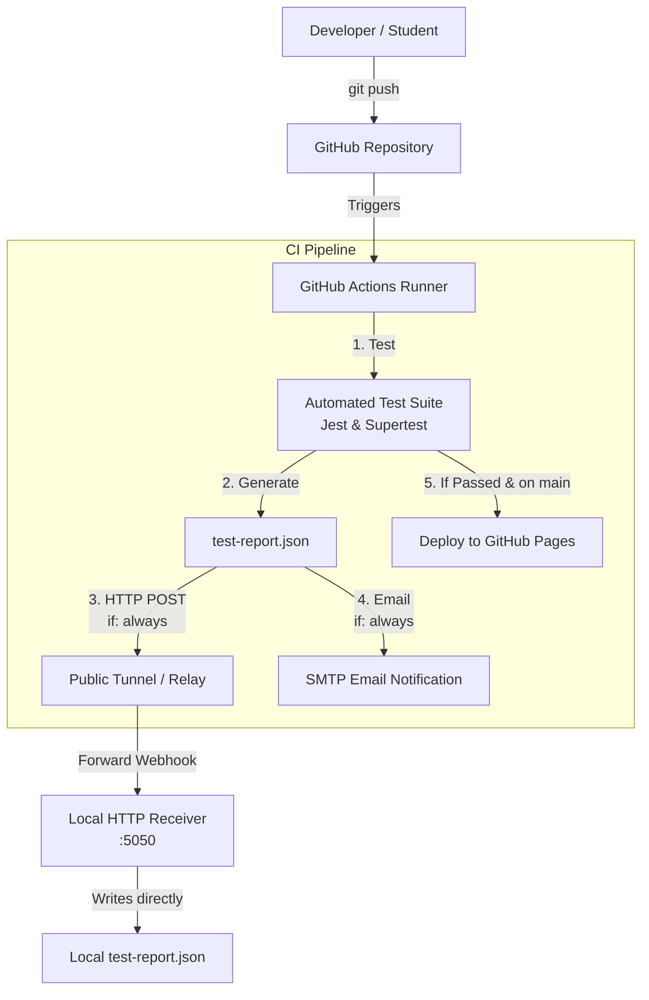

# Assignment Submission Portal — DevOps CI/CD Lab Mid

> **Course:** DevOps for Cloud Computing (CSC418)  
> **Institution:** COMSATS University Islamabad, Attock Campus  
> **Instructor:** Mr. Babar Shazad  

An automated assignment submission portal featuring a continuous integration (CI) pipeline, local HTTP test report receiver, conditional GitHub Pages deployment, and automated email reporting.

---

## 📑 Table of Contents
- [Architecture Overview](#architecture-overview)
- [Project Structure](#project-structure)
- [Prerequisites](#prerequisites)
- [Installation & Setup](#installation--setup)
- [1. Running the Portal Application](#1-running-the-portal-application)
- [2. Running the Automated Tests](#2-running-the-automated-tests)
- [3. Starting the Local Report Receiver](#3-starting-the-local-report-receiver)
- [4. Tunnel Configuration (Localhost Connectivity)](#4-tunnel-configuration-localhost-connectivity)
- [5. GitHub Actions CI/CD Pipeline & Secrets](#5-github-actions-cicd-pipeline--secrets)
- [6. Demonstration Workflow (Pass ➔ Fail ➔ Fix)](#6-demonstration-workflow-pass--fail--fix)
- [Bonus Features](#bonus-features)

---

## 🏛️ Architecture Overview



---

## 📂 Project Structure

```text
├── .github/
│   └── workflows/
│       └── ci.yml             # GitHub Actions CI/CD pipeline
├── public/                    # Frontend assets (served by Express & Pages)
│   ├── index.html             # Modern responsive web UI
│   ├── style.css              # Custom styling & dark mode aesthetics
│   └── app.js                 # UI logic (supports live backend & static demo fallback)
├── receiver/                  # Local HTTP report receiver
│   ├── server.js              # HTTP server accepting POST /report -> test-report.json
│   └── start-tunnel.js        # Helper script starting receiver + localtunnel
├── scripts/
│   ├── format-report.js       # Extracts Jest test results into required report schema
│   └── send-email.js          # Bonus: Sends test outcome emails via SMTP
├── src/
│   ├── app.js                 # Express application & API routes
│   ├── server.js              # Server entry point (:3000)
│   ├── store.js               # Submission in-memory data store
│   └── validator.js           # Input & URL validation logic
├── tests/
│   └── submission.test.js     # Jest & Supertest automated test suite
├── package.json
└── README.md
```

---

## ⚙️ Prerequisites

- **Node.js** v18+ (tested on Node 20 / 22)
- **npm** v9+
- **Git**

---

## 🚀 Installation & Setup

Clone the repository and install dependencies:

```bash
git clone <your-repository-url>
cd <repo-folder>
npm install
```

---

## 1. Running the Portal Application

To start the assignment submission portal locally:

```bash
npm start
```

Open your browser and navigate to:
```text
http://localhost:3000
```

- **API Health Check:** `http://localhost:3000/health`
- **Submissions API:** `http://localhost:3000/api/submissions`

---

## 2. Running the Automated Tests

Execute the automated test suite locally:

```bash
npm test
```

This runs Jest and executes all required test scenarios:
1. **Complete details and a valid submission URL:** The submission is saved and appears in the submission list.
2. **Missing registration number:** The submission is rejected with a validation message.
3. **Invalid submission URL:** The submission is rejected and not saved.
4. **Missing name/title:** Additional validation integrity checks.

---

## 3. Starting the Local Report Receiver

The local receiver listens on port `5050`, receives completed test reports from CI (for both passing and failing runs), and automatically updates `test-report.json` on your computer.

```bash
npm run receiver
```

- **Receiver endpoint:** `http://localhost:5050/report`
- **Receiver dashboard:** `http://localhost:5050/` (live visual inspector)
- **Target output file:** `./test-report.json`

---

## 4. Tunnel Configuration (Localhost Connectivity)

Because GitHub Actions runs on cloud runners, `localhost` on the runner refers to the runner itself. To allow GitHub Actions to reach your local receiver, expose port 5050 using a tunnel.

### Option A: Built-in Localtunnel (Recommended)
Run:
```bash
npm run receiver:tunnel
```
This automatically starts both the local receiver and a public tunnel URL (e.g., `https://random-subdomain.loca.lt`).  
Your CI endpoint will be:  
`https://random-subdomain.loca.lt/report`

### Option B: Cloudflare Tunnel (Alternative)
```bash
npx cloudflared tunnel --url http://localhost:5050
```

### Option C: ngrok (Alternative)
```bash
ngrok http 5050
```

---

## 5. GitHub Actions CI/CD Pipeline & Secrets

### Configure Repository Secrets
In your GitHub Repository, navigate to **Settings > Secrets and variables > Actions > New repository secret**:

1. **`RECEIVER_URL`** *(Required for Task 4)*:
   ```text
   https://<your-tunnel-url>/report
   ```
2. **Bonus Email Secrets** *(Optional for Bonus 2)*:
   - `EMAIL_USER`: Your SMTP email address
   - `EMAIL_PASS`: App password / SMTP password
   - `EMAIL_TO`: Recipient email address
   - `EMAIL_HOST`: e.g., `smtp.gmail.com` (default)
   - `EMAIL_PORT`: `587` (default)

### Enable GitHub Pages (For Bonus 1)
In GitHub:
1. Go to **Settings > Pages**.
2. Under **Build and deployment > Source**, select **GitHub Actions**.

---

## 6. Demonstration Workflow (Pass ➔ Fail ➔ Fix)

Follow this 3-step demonstration required by Task 5:

### Step 1: Initial Passing Run
1. Ensure your local receiver & tunnel are running (`npm run receiver:tunnel`).
2. Commit and push the working code:
   ```bash
   git add .
   git commit -m "feat: complete assignment portal with CI/CD"
   git push origin main
   ```
3. **Observation:**
   - In GitHub Actions: Workflow completes with **green checkmark (Passed)**.
   - On your local computer: `test-report.json` updates automatically with `"overallStatus": "PASSED"`, 4 passed tests, and 0 failures.

### Step 2: Introduce a Defect (Failing Run)
1. Open [`src/validator.js`](file:///home/huzaifa/Projects/Work/University%20Stuff/DevOPs/lab/mid/src/validator.js) and intentionally break validation (for example, comment out the registration number validation or invert the URL condition):
   ```javascript
   // In src/validator.js, comment out this check:
   // if (!regNo || typeof regNo !== 'string' || !regNo.trim()) {
   //   errors.push('Registration number is required.');
   // }
   ```
2. Commit and push the defect:
   ```bash
   git add src/validator.js
   git commit -m "test: introduce defect in regNo validation"
   git push origin main
   ```
3. **Observation:**
   - In GitHub Actions: Workflow fails on the test step (**red cross**).
   - The conditional GitHub Pages deployment step is **skipped** (previous version left unchanged).
   - On your local computer: `test-report.json` is **still received and updated**, showing `"overallStatus": "FAILED"` along with the exact failure details!

### Step 3: Fix the Defect (Corrected Run)
1. Restore the original validation code in [`src/validator.js`](file:///home/huzaifa/Projects/Work/University%20Stuff/DevOPs/lab/mid/src/validator.js).
2. Commit and push:
   ```bash
   git add src/validator.js
   git commit -m "fix: restore registration number validation"
   git push origin main
   ```
3. **Observation:**
   - In GitHub Actions: Workflow turns **green (Passed)** again.
   - Pages deployment executes successfully.
   - On your local computer: `test-report.json` updates with `"overallStatus": "PASSED"`.

---

## 🎁 Bonus Features Implemented

1. **Conditional Deployment (5 marks):**
   - Configured in [`.github/workflows/ci.yml`](file://.github/workflows/ci.yml) with `needs: test` and `if: github.ref == 'refs/heads/main' && success()`.
   - Only publishes the frontend to GitHub Pages when tests pass. Any failing test halts deployment, leaving the existing site intact.

2. **Automated Email Reports (5 marks):**
   - Implemented via [`scripts/send-email.js`](file://scripts/send-email.js).
   - Runs under `if: always()`, transmitting formatted HTML test results and JSON attachments directly to the specified inbox for both passing and failing pipeline runs.
